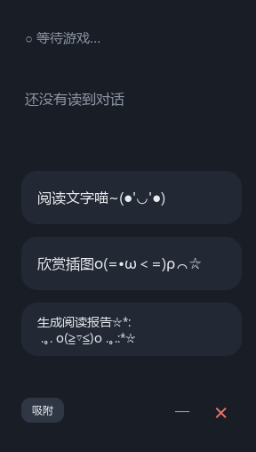

# Dafeiyu's Wonder Reading

[简体中文](README.md) | **English**

A **DSH (DeepSeek Harness) plugin** for *BLACK SOULS II*. It logs the dialogue you read — line, speaker,
map, and where it came from — and hands it to the AI only when you press a button: to read it, to look at
a screenshot, or to write a reading report. Ships with a sidebar panel and a floating widget that docks
beside the game window.



> **Disclaimer**: This is an unofficial plugin. It has no affiliation with *BLACK SOULS II* or its author.
> This repository contains **no game assets** (no scripts, images, audio or text); it only reads files that
> already exist on the player's own machine.

---

## 1. Before you start

| You need | Why |
| --- | --- |
| **DSH** (DeepSeek Harness) | This plugin is a Cordis plugin; it lives in DSH's `bundles/` directory |
| **BLACK SOULS II** | Your own copy (Windows) |
| **[`black-souls-mcp`](https://github.com/yk4464/black-souls-mcp)** (MIT) | The bridge that turns game state into JSON files; that is what this plugin reads |
| **Two small bridge patches** | Upstream has neither speaker names nor an F9 trigger; a bundled script adds them |
| **Python 3 + Pillow** | Only for the floating widget; without Pillow the widget will not start (the panel still works) |

Without the bridge (or its patches) the plugin still installs, but it will sit at "○ waiting for the game…"
and record nothing.

**Interface language**: the sidebar panel follows DSH's language (full Chinese and English strings);
**the floating widget is Chinese-only for now** — its status line and the "吸附" (re-dock) button have no
English strings yet.

## 2. Things to know first

1. **Tokens are spent only when you press a button.** Recording, writing files and drawing the widget are
   all local; handing anything to the AI is always your call (the three panel buttons, or F9 in game).
2. **It modifies a game file.** The patch rewrites your local `Scripts.rvdata2` (a backup is taken first).
   Verifying game files, updating or reinstalling the game may overwrite it or fail the integrity check —
   so **keep that `.bak`**.
3. **Set a report folder.** Pressing "generate report" without `reportDir` asks you to configure it; it never
   writes anywhere unexpected.
4. **Clearing history backs up first.** "Clear reading history" leaves `dialogue-<time>.bak.*` beside the
   originals.
5. **Windows only.** The widget leans on Win32 APIs (window docking, per-pixel transparency, hit testing).
6. **Everything stays local.** Records go to `dataDir`, screenshots to `dataDir/shots/`; nothing is uploaded.
7. **F9 needs a game restart**, because the patch lands in scripts loaded at startup.

## 3. Install

```bash
# 1. drop it into your bundles directory
cp -r dafeiyu-wonder-reading <DSH workspace>/bundles/

# 2. copy the sample config and fill in your two paths
cp cordis.patch.yml.example cordis.patch.yml
```

At minimum, edit these two keys in `cordis.patch.yml`:

| Key | Meaning |
| --- | --- |
| `gameDir` | The game copy that contains `BridgeRuntime/state/*.json` |
| `dataDir` | Where records go (`dialogue.md`, `dialogue.jsonl`, `settings.json`) |

Then enable `@local/dsh-dafeiyu-wonder-reading` in DSH's plugin manager, refresh the page, and the sidebar
entry appears.

### Patch the bridge

```bash
python scripts/apply_bridge_patch.py <your black-souls-mcp>/rgss/BlackSoulsBridge.rb
```

The script backs the file up, then adds the three pieces it is missing (speaker / event source / F9) and
skips anything already present, so it is safe to run repeatedly. Afterwards still use upstream's
`patch_rvdata2_binary.py` to inject the script into the game, **then restart the game**.
Details: [`docs/PATCH.md`](docs/PATCH.md).

## 4. Usage

- **Recording is free**: while the game runs, the plugin keeps writing records without bothering the AI.
- **Handing over is your call**: "阅读文字" (read the text), "欣赏插图" (look at the screenshot),
  "生成阅读报告" (write a report).
- **F9 in game** does the same as "read the text".
- **Floating widget**: docked to the right of the game window, collapses into a thin line; drag it away to
  detach, press "吸附" (re-dock) to bring it back.

## 5. Settings

Available in the panel's settings area; also stored in `dataDir/settings.json`.

| Key | Default | Meaning |
| --- | --- | --- |
| `gameDir` | — | Game copy directory |
| `dataDir` | `~/Documents/deepseek-harness/default-workspace/阅读记录` | Where records go |
| `reportDir` | empty | Where reports go; empty = the button asks you first |
| `autoAnalyze` | `false` | Hand lines over automatically (costs tokens, off by default) |
| `widgetAutoStart` | `true` | Start the widget with DSH |
| `dockMode` | `normal` | `strong` = snap back whenever the game window moves |
| `reportAgentId` | empty | Which session receives the report; empty = the topmost one |
| `ignoreFleeLines` | `true` | Drop battle lines like "XXX fled" |

## 6. What a record looks like

`dialogue.md` is meant for humans: one time, one place, one speaker per block.

```
- 白之兔诺登：「欢迎回来，大人。」
- 〔血迹〕前方那，当心可爱的家伙。
- [战斗] 敌人逃跑了
```

Sources are kept apart: a name means a speaker, `〔血迹〕/〔尸体〕/〔告示牌〕` (bloodstain / corpse / sign)
means you examined something on the ground, `[战斗]` (battle) is a combat notice. Lines with none of these
are genuine narration.

## 7. Repository layout

| Path | Purpose |
| --- | --- |
| `index.js` | Host half: polls the bridge, folds lines into blocks, hands them to the agent |
| `client.js` | Sidebar panel |
| `widget.py` / `painter.py` | Floating widget and its Pillow drawing layer |
| `cordis.patch.yml.example` | Config sample |
| `scripts/apply_bridge_patch.py` | One-step bridge patch |
| `scripts/release.mjs` | Builds a clean release copy (strips local paths) |
| `docs/PATCH.md` | Notes on the bridge patches |
| `docs/DETAIL.md` | Implementation details |

## 8. Want to change something?

- **Bugs and ideas**: open an Issue. "Where, what you pressed, what you expected, what happened" is already
  enough.
- **Code**: forks and pull requests are welcome — especially how the widget behaves on other resolutions and
  other window managers; I cannot test those alone.
- **Talk to me**: [Bilibili @大肥鱼](https://space.bilibili.com/3546903757195991) (UID: 3546903757195991)

> No need to be shy — come say hi.

## 9. License

MIT, see [`LICENSE`](LICENSE).
