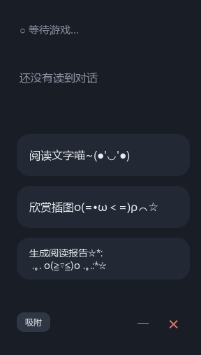

# 大肥鱼的不思议阅读

给《BLACK SOULS II》做的一个 DSH 插件：把游戏里的对话记下来（台词 + 说话人 + 地图 + 是碰了血迹/尸体），
按下按钮才交给 agent 阅读、看插图、写阅读报告。带一个左侧栏面板和一个吸在游戏窗口旁边的 Python 悬浮窗。



> **免责声明**：这是非官方插件，与《BLACK SOULS II》及其原作者没有任何关系。
> 本仓库**不包含任何游戏资源**（脚本、图像、音频、文本都不含），只读取玩家本机上已存在的游戏数据。

## 它需要什么

1. **DSH**（DeepSeek Harness）本体；
2. 本机有《BLACK SOULS II》，并通过 **`black-souls-mcp`** 的桥接器把游戏状态写成 JSON；
3. 桥接器里需要有 `speaker_summary` 和 `poll_send_hotkey` 两个补丁函数——上游版本没有，见 [`docs/PATCH.md`](docs/PATCH.md)。

缺第 2、3 条时插件也能装，但只会一直显示「○ 等待游戏…」。

第 3 条不用手改代码，仓库里带了脚本：

```bash
python scripts/apply_bridge_patch.py <你的 black-souls-mcp>/rgss/BlackSoulsBridge.rb
```

它会先备份，再补上需要的东西（已有就跳过，可以反复跑）。打完仍然要用上游的
`patch_rvdata2_binary.py` 把脚本打进游戏，然后重启游戏。

## 安装

```bash
# 1. 放进 bundles 目录
cp -r dafeiyu-wonder-reading <DSH 工作区>/bundles/

# 2. 复制配置样板，填上你自己的两个路径
cp cordis.patch.yml.example cordis.patch.yml
```

`cordis.patch.yml` 里至少要改这两项：

| 键 | 说明 |
| --- | --- |
| `gameDir` | 游戏副本目录（里面有 `BridgeRuntime/state/*.json`） |
| `dataDir` | 阅读记录写到哪（会生成 `dialogue.md`、`dialogue.jsonl`、`settings.json`） |

然后在 DSH 的插件管理里启用 `@local/dsh-dafeiyu-wonder-reading`，刷新页面，左侧栏会出现入口。

## 怎么用

- **记录是免费的**：只要游戏在跑，插件就一直在写记录，不会打扰 agent。
- **交给我要你按**：面板上的「阅读文字喵~」「欣赏插图」「生成阅读报告」，按了才会把内容发给我。
- **游戏里按 F9** 也等于按「阅读文字」（需要第 3 条补丁）。
- **悬浮窗**：贴在游戏窗口右边，收起后变成一条竖线；拖动它会脱离，点「吸附」回来。

## 配置项

全部可在面板的设置区调整，也会写进 `dataDir/settings.json`。

| 键 | 默认 | 说明 |
| --- | --- | --- |
| `gameDir` | 无 | 游戏副本目录 |
| `dataDir` | `~/Documents/deepseek-harness/default-workspace/阅读记录` | 记录写在哪儿 |
| `reportDir` | 空 | 阅读报告写到哪儿；空则按钮会提示先设置 |
| `autoAnalyze` | `false` | 自动交给我（会花 token，默认关） |
| `widgetAutoStart` | `true` | 随 DSH 启动悬浮窗 |
| `dockMode` | `normal` | `strong` = 游戏窗口一动就贴回去 |
| `reportAgentId` | 空 | 阅读报告交给哪个会话；空 = 侧栏最上面那个 |
| `ignoreFleeLines` | `true` | 屏蔽「XXX逃跑了」这类战斗提示 |

## 许可

MIT，见 [`LICENSE`](LICENSE)。
